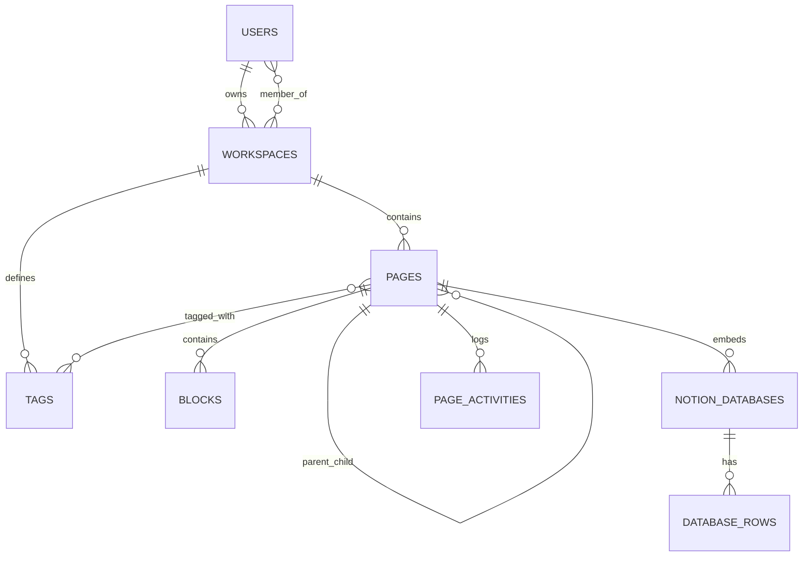

# سياق المشروع وتوثيقه المعماري (PROJECT_CONTEXT.md)

> **اسم المشروع:** Ticket  
> **البيئة والإصدار:** Laravel 13 (PHP 8.4) — Hybrid Monolith Architecture  
> **آخر تحديث:** 2026-11-12  

---

## 1. فكرة المشروع (Project Concept)
تطبيق لإدارة مساحات العمل والملاحظات والمهام وقواعد البيانات والوثائق، يحاكي تجربة تطبيق **"نوشن" (Notion)**. يركز على:
- بنية هرمية لا نهائية للصفحات (Nested Pages).
- تحرير قائم على البلوكات المرنة (Block-based Editor) مع قائمة أوامر `/` وتلوين حي للأكواد وألوان للملاحظات.
- قواعد بيانات مضمنة متعددة العروض (`Table`, `Board`, `Gallery`).
- واجهة مستخدم داكنة افتراضياً (Soft Charcoal Dark Mode `#191919` / `#202020`) مع خط **Kashif Arabic** ومظهر بسيط خالٍ من التعقيد.

---

## 2. التقنيات المستخدمة (Tech Stack)

### الخلفية (Backend)
- **PHP 8.4** مع التزام كامل بالأنواع الصريحة (Strict Return & Param Types).
- **Laravel 13** كمعمارية Hybrid Monolith متكاملة.
- **Laravel Sanctum** لمصادقة الـ API Tokens بجانب مصادقة الجلسات (Session-based Auth).
- **MySQL / SQLite** كقاعدة بيانات علائقية مع حقول `JSON`.

### الواجهة الأمامية (Frontend)
- **Blade Templates:** محرك القوالب الأساسي.
- **Tailwind CSS (via CDN):** مع إعداد `darkMode: 'class'` وتفعيل الوضع الليلي افتراضياً.
- **Alpine.js (via CDN):** لإدارة الحالة التفاعلية (Inline Editing, Slash Menu, Database Views, Overview Panel, Search Modal).
- **SortableJS (via CDN):** لإعادة ترتيب البلوكات بالسحب والإفلات.
- **Prism.js (via CDN):** لتلوين الأكواد البرمجية في بلوكات `code` بحسب اللغة المختارة.
- **Kashif Arabic Font:** مستضاف محلياً في `public/fonts/KashifArabic.otf`.

---

## 3. هيكل المشروع (Project Structure)

```text
notion-clone/
├── app/
│   ├── Http/
│   │   ├── Controllers/
│   │   │   ├── AuthController.php             # مصادقة الويب والـ API
│   │   │   ├── WorkspaceController.php        # إدارة مساحات العمل وعرضها
│   │   │   ├── WorkspaceMemberController.php  # إدارة أعضاء المساحة وصلاحياتهم
│   │   │   ├── PageController.php             # الصفحات، المفضلة، الأغلفة، تصدير Markdown
│   │   │   ├── BlockController.php            # البلوكات (إضافة، تعديل، لون، لغة، ترتيب، حذف)
│   │   │   ├── DatabaseController.php         # قواعد البيانات المضمنة وسجلاتها
│   │   │   ├── TagController.php              # الوسوم وربطها بالصفحات
│   │   │   ├── TemplateController.php         # القوالب الجاهزة وتطبيقها
│   │   │   └── SearchController.php           # البحث الفوري (Ctrl+K)
│   ├── Models/
│   │   ├── User.php
│   │   ├── Workspace.php
│   │   ├── Page.php
│   │   ├── Block.php
│   │   ├── Tag.php
│   │   ├── NotionDatabase.php
│   │   ├── DatabaseRow.php
│   │   ├── Template.php
│   │   └── PageActivity.php
├── database/
│   ├── migrations/                            # جداول المستخدمين، المساحات، الصفحات، البلوكات، الوسوم، القواعد، القوالب، النشاط
│   └── seeders/
│       └── TemplateSeeder.php                 # بذر القوالب الافتراضية
├── public/
│   └── fonts/
│       └── KashifArabic.otf                   # خط النظام الافتراضي
├── resources/
│   └── views/
│       ├── layouts/
│       │   └── app.blade.php                  # الهيكل الأساسي، الوضع الليلي الافتراضي، Search Modal، Prism.js
│       ├── components/
│       │   ├── sidebar.blade.php              # الشريط الجانبي (الاختصارات، المفضلة، الشجرة، الإعدادات)
│       │   └── sidebar-page-item.blade.php    # عنصر صفحة متداخل (Recursive)
│       ├── auth/
│       │   ├── login.blade.php
│       │   └── register.blade.php
│       ├── workspaces/
│       │   ├── show.blade.php                 # الصفحة الرئيسية لمساحة العمل (2-Column Cards)
│       │   └── settings.blade.php             # إعدادات مساحة العمل والأعضاء
│       ├── templates/
│       │   └── index.blade.php                # مكتبة القوالب (2-Column Cards)
│       ├── pages/
│       │   └── show.blade.php                 # المحرر، قواعد البيانات، TOC Minimap، Overview Panel
│       └── dashboard.blade.php                # إنشاء أول مساحة عمل
├── routes/
│   ├── web.php
│   └── api.php
├── README.md
├── PROJECT_CONTEXT.md
└── PROGRESS.md
```

---

## 4. المعمارية (Architecture Overview)

يعتمد المشروع على نمط **Hybrid Monolith**:
1. **Blade كواجهة أساسية:** تحميل سريع ومنظم للبيانات من الـ Controllers.
2. **Alpine.js + Fetch API للتفاعل الفوري:** تعديل العنوان، الأيقونة، الغلاف، المفضلة، البلوكات (النص، اللون، اللغة، الحالة)، وسجلات قواعد البيانات دون إعادة تحميل الصفحة.
3. **Dual-Response Controllers:** تدعم طلبات المتصفح العادية وطلبات JSON (`wantsJson()`).

---

## 5. قواعد كتابة الكود (Coding Conventions & Rules)

- **PHP 8.4 Standards:** أنواع إرجاع ومعاملات صريحة، أقواس معقوفة `{ ... }` لجميع جمل التحكم، وتنسيق عبر **Laravel Pint** (`vendor/bin/pint --dirty --format agent`).
- **Laravel Best Practices:** استخدام `route()`، وتجنب `$request->content` لصالح `$request->input(...)`، وتمرير البيانات المعقدة من Blade إلى JavaScript عبر `\Illuminate\Support\Js::from(...)` بدلاً من `@json(...)` متعدد الأسطر.
- **Frontend Conventions:**
  - استخدام `x-cloak` مع Alpine.js.
  - لوحة ألوان Notion الداكنة (`#191919` للمحرر، `#202020` للسايدبار، `#252525` للقوائم المنبثقة، `#2E2E2E` للحدود، `#E3E3E0` للنصوص).
  - الوضع الليلي افتراضي مع منع الوميض (`FOUC`) عبر سكريبت مبكر في `<head>`.

---

## 6. الجداول والعلاقات (Database Schema & Relations)



### العلاقات الأساسية في Eloquent:
- `Workspace`: `owner()`, `members()`, `pages()`, `tags()`.
- `Page`: `workspace()`, `parent()`, `children()`, `creator()`, `blocks()`, `tags()`, `databases()`, `activities()`.
- `NotionDatabase`: `page()`, `rows()`.
- `Block`: `page()`.

---

## 7. القرارات الهندسية الهامة (Decisions & Troubleshooting)

1. **تجنب تعارض `@json(...)` في Blade:** عند تمرير مجموعات متداخلة تحتوي على Closures (مثل بيانات قواعد البيانات في `pages/show.blade.php`)، يتم تجهيز المصفوفة في `@php` وتمريرها عبر `\Illuminate\Support\Js::from(...)` لتفادي أخطاء تحليل أقواس Blade.
2. **تخزين خصائص البلوكات في JSON:** حقول `checked`, `open`, `color`, `language`, `link_page_id` تُخزن داخل `blocks.content` مما يتيح توسيع أنواع البلوكات دون تعديل الجداول.
3. **تلوين الأكواد الحي (Prism.js Overlay):** استخدام طبقة `<pre><code>` متزامنة أسفل `<textarea>` شفاف لتوفير تلوين فوري للأكواد أثناء الكتابة مع الحفاظ على محاذاة المؤشر.
