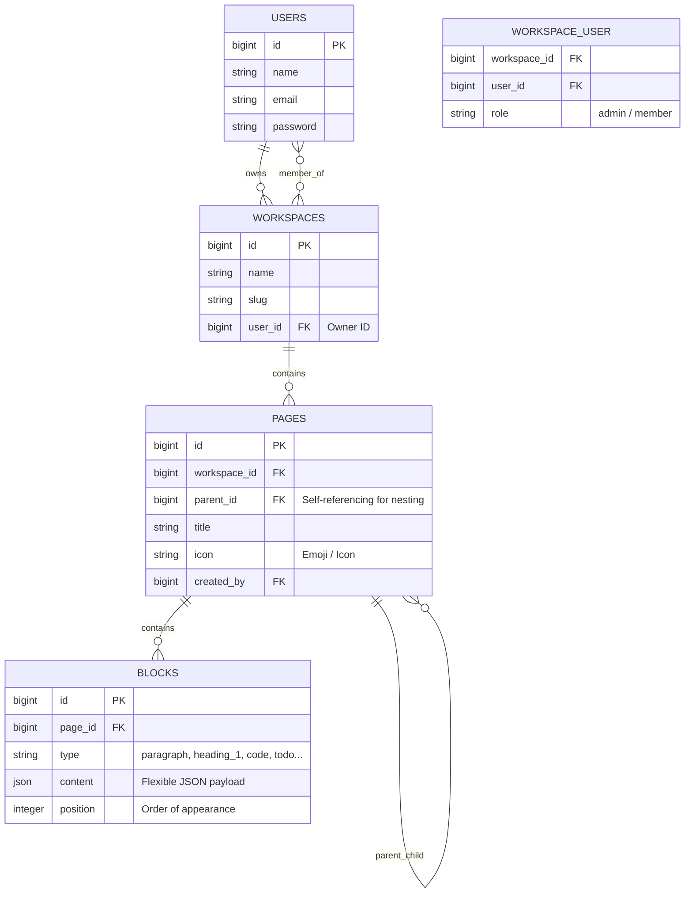

# سياق المشروع وتوثيقه المعماري (PROJECT_CONTEXT.md)

> **اسم المشروع:** Notion Clone (نوشن المصغر)  
> **البيئة والإصدار:** Laravel 11 / 12 (PHP 8.4) — Monolith Architecture  
> **آخر تحديث:** 2026-11-10  

---

## 1. فكرة المشروع (Project Concept)
تطبيق لإدارة مساحات العمل والملاحظات والمهام والوثائق، يحاكي تجربة تطبيق **"نوشن" (Notion)** الشهير. يركز على:
- بنية هرمية لا نهائية للصفحات (صفحات داخل صفحات - Nested Pages).
- تحرير قائم على البلوكات المرنة (Block-based Editor) مثل النصوص، العناوين، الكود، المهام، الاقتباسات، والتنبيهات.
- تجربة مستخدم سلسة ومباشرة، مع حفظ تفاعلي فوري ومظهر بسيط ونظيف (Clean Minimalist UI) بألوان مستوحاة من نوشن (White / Gray / Slate).

---

## 2. التقنيات المستخدمة (Tech Stack)

### الخلفية (Backend)
- **PHP 8.4** مع معايير الأداء والأنماط الحديثة.
- **Laravel Framework** كمعمارية Monolith متكاملة.
- **Laravel Sanctum** لدعم مصادقة الـ API Tokens بجانب مصادقة الجلسات (Session-based Auth).
- **SQLite / MySQL** كقاعدة بيانات علائقية.

### الواجهة الأمامية (Frontend)
- **Blade Templates:** محرك القوالب الأساسي للنظام الأحادي (Monolith).
- **Tailwind CSS (via CDN):** لتصميم سريع، متجاوب، ومخصص بدرجات ألوان نوشن الرسمية.
- **Alpine.js (via CDN):** لإدارة الحالة التفاعلية في المتصفح (فتح وإغلاق القوائم، التعديل المباشر Inline Editing، والطلبات غير المتزامنة Fetch/AJAX) بدون الحاجة إلى إطارات SPA معقدة (مثل React أو Vue).
- **SortableJS (via CDN):** لدعم السحب والإفلات وإعادة ترتيب البلوكات بسلاسة.

---

## 3. هيكل المشروع (Project Structure)

```text
notion-clone/
├── app/
│   ├── Http/
│   │   ├── Controllers/
│   │   │   ├── AuthController.php        # مصادقة API والتحكم بالمستخدمين
│   │   │   ├── WorkspaceController.php   # إدارة مساحات العمل وعرضها
│   │   │   ├── PageController.php        # إنشاء وحذف وتعديل الصفحات والشجرة
│   │   │   └── BlockController.php       # إدارة البلوكات (إضافة، تعديل، ترتيب، حذف)
│   ├── Models/
│   │   ├── User.php                      # المستخدم وعلاقاته بمساحات العمل والصفحات
│   │   ├── Workspace.php                 # مساحة العمل والأعضاء والصفحات التابعة
│   │   ├── Page.php                      # الصفحة وشجرتها الهرمية وبلوكاتها
│   │   └── Block.php                     # البلوك ونوعه ومحتواه المرن (JSON)
├── database/
│   └── migrations/
│       ├── ..._create_users_table.php
│       ├── ..._create_workspaces_table.php
│       ├── ..._create_workspace_user_table.php
│       ├── ..._create_pages_table.php
│       └── ..._create_blocks_table.php
├── resources/
│   └── views/
│       ├── layouts/
│       │   └── app.blade.php             # الهيكل الأساسي (Header, Sidebar Container, Scripts)
│       ├── components/
│       │   └── sidebar.blade.php         # القائمة الجانبية والشجرة الهرمية التفاعلية
│       ├── auth/
│       │   ├── login.blade.php           # شاشة تسجيل الدخول
│       │   └── register.blade.php        # شاشة إنشاء حساب جديد
│       ├── workspaces/
│       │   └── show.blade.php            # عرض مساحة العمل والترحيب
│       ├── pages/
│       │   └── show.blade.php            # محرر البلوكات والصفحات الفرعية
│       └── dashboard.blade.php           # صفحة إنشاء أول مساحة عمل
├── routes/
│   ├── web.php                           # مسارات المتصفح وقوالب Blade
│   └── api.php                           # مسارات الـ RESTful API
└── PROJECT_CONTEXT.md                    # هذا الملف (دليل وسياق المشروع)
```

---

## 4. المعمارية (Architecture Overview)

يعتمد المشروع على نمط **Hybrid Monolith**:
1. **Blade كواجهة أساسية:** يتم استدعاء الصفحات وتمرير البيانات من الـ Controllers بالطريقة التقليدية السريعة، مما يحافظ على بساطة الـ SEO وسرعة التحميل الأولى.
2. **Alpine.js للتفاعل الفوري:** العمليات الدقيقة (تعديل العنوان `Inline-edit`، تحديد الـ Todo Checkbox، تعديل محتوى البلوك) تتم عبر طلبات خلفية `Fetch API (PUT / DELETE / POST)` دون عمل Refresh كامل للصفحة.
3. **Dual-Response Controllers:** صُممت الـ Controllers لتخدم طلبات الـ Web العادية وتعيد `view()` أو `redirect()`، وفي حال كان الطلب `wantsJson()` تعيد استجابة JSON فورية متوافقة مع طلبات الـ Ajax / Alpine.

---

## 5. قواعد كتابة الكود (Coding Conventions & Rules)

- **PHP 8.4 Standards:**
  - استخدام الأنواع الصريحة (Explicit Return & Param Types).
  - استخدام Constructor Property Promotion عند الحاجة.
  - إحاطة جمل التحكم بالأقواس المعقوفة دائماً `{ ... }`.
- **Laravel Best Practices:**
  - استخدام التوجيهات المسماة (Named Routes) مع المساعد `route()`.
  - الالتزام بتنسيق كود Laravel عبر **Laravel Pint** (`vendor/bin/pint --format agent`).
  - تجنب استدعاء الخصائص المحمية في الطلبات؛ استخدام `$request->input('field')` بدلاً من `$request->field` لمنع تعارضات محلل الـ IDE أو الخصائص المحمية في سيمفوني.
  - الحذف المتتالي (Cascade on Delete) في قواعد البيانات لضمان عدم بقاء بيانات يتيمة عند حذف صفحة أو مساحة عمل.
- **Frontend Conventions:**
  - استخدام التوجيه `x-cloak` دائماً في عناصر Alpine.js التي تختفي لتفادي وميض المحتوى قبل التحميل (FOUC).
  - التناسق اللوني مع درجات رمادية محايدة (`#F7F7F5` للسايدبار، `#E9E9E7` للحدود، `#37352F` للنصوص الرئيسية).

---

## 6. الجداول وقاعدة البيانات والعلاقات (Database Schema & Relations)



### العلاقات في Eloquent:
- `Workspace -> owner()` : BelongsTo(User)
- `Workspace -> members()` : BelongsToMany(User, 'workspace_user')
- `Workspace -> pages()` : HasMany(Page)
- `Page -> workspace()` : BelongsTo(Workspace)
- `Page -> parent()` : BelongsTo(Page, 'parent_id')
- `Page -> children()` : HasMany(Page, 'parent_id')
- `Page -> blocks()` : HasMany(Block)->orderBy('position')
- `Block -> page()` : BelongsTo(Page)

---

## 7. ما تم تنفيذه حتى الآن (Implemented Features)

- [x] **نظام المصادقة (Auth):** تسجيل الدخول، إنشاء حساب، والخروج، مع شاشات نظيفة بتنسيق نوشن.
- [x] **مساحات العمل (Workspaces):** دعم إنشاء مساحات العمل وربط المالك والأعضاء بها وتوليد الـ Slugs.
- [x] **القائمة الجانبية وشجرة الصفحات الهرمية (Sidebar & Nested Pages):**
  - شجرة لا نهائية للصفحات والصفحات الفرعية (Root & Children).
  - دعم زر الطي والفتح (Chevron Toggle).
  - زر `(+)` لإضافة صفحة فرعية فورية من القائمة الجانبية أو من داخل الصفحة.
  - زر لحذف الصفحة مع بنودها التابعة.
  - إمكانية طي وإظهار السايدبار بالكامل من الزر العلوي.
- [x] **عرض الصفحات المتداخلة داخل المحتوى (Sub-pages in Page View):**
  - عرض بطاقات أنيقة لأي صفحات داخلية تابعة للصفحة المعروضة حالياً مع روابط سريعة لدخولها.
- [x] **محرر البلوكات الشامل (Multi-type Block Editor):**
  - **نص عادي (Paragraph):** متعدد الأسطر مع تمدد تلقائي.
  - **عناوين مختلفة:** Heading 1، Heading 2، و Heading 3.
  - **قائمة مهام (To-do):** Checkbox تفاعلي يشطب النص ويحفظ الحالة تلقائياً عبر Ajax.
  - **كتلة كود برمجى (Code Snippet):** محرر داكن مريح ومميز مع زر نسخ الكود.
  - **صندوق ملاحظة/تنبيه (Callout):** خلفية مميزة وأيقونة بارزة.
  - **اقتباس مميز (Quote):** خط عمودي أنيق ونص مائل.
  - **قوائم تنظيمية:** قائمة نقطية (Bullet List)، قائمة مرقمة (Numbered List)، وخط فاصل (Divider).
  - **حذف وتعديل البلوكات:** حفظ فوري عند الـ `blur` وزر حذف عند الـ `hover`.
- [x] **تعديل الأيقونة الفوري (Emoji Picker):** تغيير أيقونة الصفحة وتحديثها في قاعدة البيانات فورياً.
- [x] **العنوان التفاعلي (Inline Editable Title):** تعديل العنوان في مكانه بدون الحاجة لنموذج منفصل.

---

## 8. المشاكل والقرارات الهندسية الهامة (Decisions & Troubleshooting)

1. **مشكلة `Member has protected visibility` في `BlockController.php`:**
   - *السبب:* استخدام `$request->content` سبب تحذير IDE / static analysis بسبب وراثة `Request` لخاصية محمية `$content` من Symfony.
   - *الحل:* استبدالها بـ `$request->input('content')` الرسمية لتفادي الغموض.
2. **اعتماد نمط التخزين المرن للبلوكات `json content`:**
   - *القرار:* بدلاً من إنشاء جداول منفصلة لكل نوع من البلوكات، تم استخدام جدول موحد `blocks` يحتوي على حقل `type` وحقل `json content`. هذا يسمح بإضافة أنواع بلوكات لا حصر لها مستقبلاً دون تعديل في بنية الجداول.
3. **قرار الـ Sidebar في الـ Layout:**
   - *المشكلة السابقة:* استخدام الـ `@slot('sidebar')` في بعض الصفحات كان يسبب اختفاء القائمة الجانبية عند تحميل مسارات معينة.
   - *الحل المعماري:* جعل السايدبار مكوّناً أساسياً مضمناً عبر `@include('components.sidebar')` داخل الـ Layout الأساسي لضمان ثباته وظهوره الدائم والتحكم به عبر زر الطي والفتح بسلاسة.

